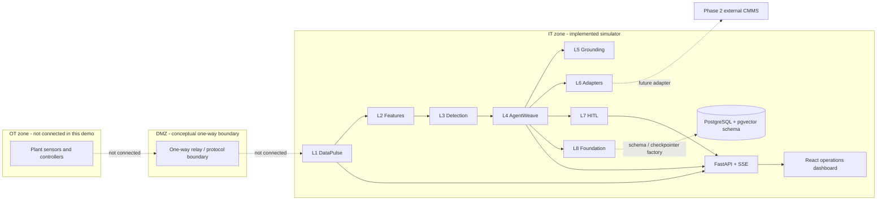
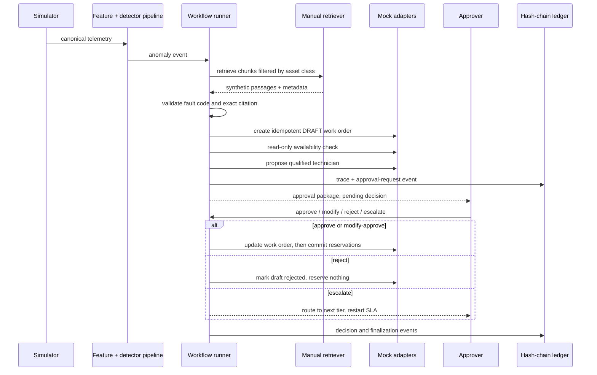
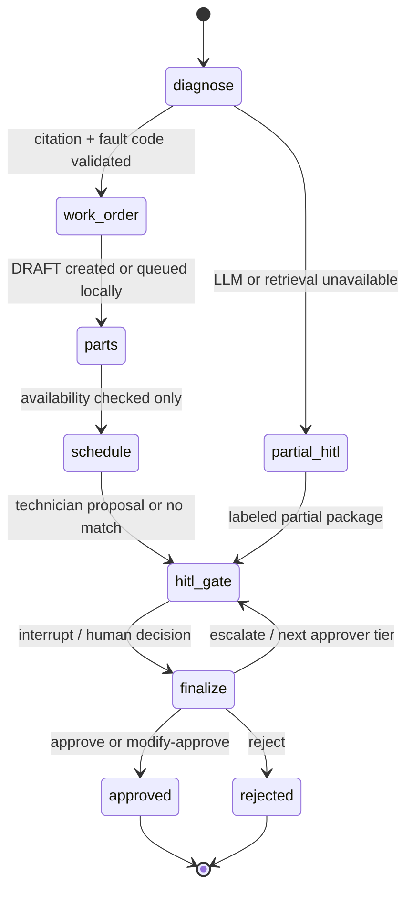

# Agentic Maintenance Workflow

An independent, simulated maintenance-operations demo. It turns generated sensor readings into anomaly events, retrieves source passages from synthetic manuals, drafts a work order, checks inventory and technician fit, and pauses for human approval before confirming work or reserving parts. Workflow decisions are recorded in a SHA-256 hash-chained audit ledger.

## Scope and Safety

- The plant and all telemetry are simulated. There is no OT connectivity, PLC/MQTT bridge, or one-way relay implementation.
- CMMS, inventory, and scheduling are in-memory mocks behind adapter interfaces. Maximo and SAP PM classes are non-operational stubs that raise `NotImplementedError`.
- The API demo runtime stores state in process memory. SQLAlchemy metadata, an Alembic schema, and a Postgres checkpointer factory are provided, but the live API is not yet wired to persist its runtime records or resume them after a restart.
- The manuals are synthetic demo content, not OEM documentation. Do not use them for real maintenance or clinical service instructions.
- The development approver header is an identity hook only, not production authentication. Add OIDC/API-key verification, authorization, TLS, and secrets management before deployment.
- No action is automatically approved. Availability checks are read-only; part reservations are created only after an approve or modify-approve decision.
- Missing safety classification is treated as safety-critical.

## Contents

- [Architecture](#architecture)
- [Application Components](#application-components)
- [Data Model](#data-model)
- [Simulator](#simulator)
- [API Reference](#api-reference)
- [Approval Rules](#approval-rules)
- [LLM Use](#llm-use)
- [Dashboard](#dashboard)
- [Quick Start](#quick-start)
- [Configuration](#configuration)
- [Targets](#targets)
- [Research and Decisions](#research-and-decisions)
- [Build Plan](#build-plan)
- [Demo Walkthrough](#demo-walkthrough)
- [Repository](#repository)
- [Roadmap](#roadmap)

## Architecture

The OT/DMZ diagram shows the intended trust boundary, not a deployed connectivity path. The current build starts at the simulator inside the IT demo runtime.







## Application Components

| Layer | Responsibility | Main modules |
| --- | --- | --- |
| L1 DataPulse | Synthetic sensor source, unit normalization, bounded bus, pipeline runner, and event publishing | `backend/app/datapulse/` |
| L2 Features | Rolling windows, RMS/statistics, rate of change, vibration FFT peaks, operating context, health index | `backend/app/datapulse_ai/features.py` |
| L3 Detection | Per-asset SPC/5-sigma/CUSUM, optional calibrated Isolation Forest, weighted ensemble, quiet/dedup suppression | `backend/app/datapulse_ai/detection/`, `backend/app/datapulse_ai/model_store.py` |
| L4 AgentWeave | Diagnosis/work-order proposal, policy, workflow state, LangGraph gate declaration, in-memory demo workflow runner | `backend/app/agentweave/` |
| L5 Grounding | Section chunking, known fault library, asset-class filtered keyword retrieval, exact citation validator | `backend/app/grounding/` |
| L6 Adapters | CMMS, inventory, and scheduling contracts; mocks; Maximo/SAP PM placeholders | `backend/app/adapters/` |
| L7 HITL | Approval facade, approver identity hook, SLA warning/escalation, notifications | `backend/app/hitl/` |
| L8 Foundation | SHA-256 audit ledger, SQLAlchemy metadata, Alembic migration, database/checkpointer helpers | `backend/app/foundation/`, `backend/alembic/` |

### Backend Entry Points

| Module | What it owns |
| --- | --- |
| `backend/app/main.py` | FastAPI application, CORS, lifespan, and versioned router registration |
| `backend/app/config.py` | Environment configuration and repository-root `.env` loading |
| `backend/app/runtime.py` | Process-local demo services and simulator-to-workflow callback wiring |
| `backend/app/api/routes/v1.py` | Health/config/fleet/telemetry/anomaly/workflow/approval/audit/KPI/LLM/simulator/SSE routes |
| `backend/app/schemas/domain.py` | Strict Pydantic domain contracts for telemetry, assets, diagnosis, orders, decisions, and audit |
| `backend/app/agentweave/runner.py` | Offline fake-LLM workflow facade used by the API and demo script |
| `backend/app/agentweave/graph.py` | LangGraph graph declaration with an isolated `interrupt()` gate; not the API decision-resume path yet |
| `backend/app/foundation/models.py` | SQLAlchemy metadata for assets, telemetry, workflows, decisions, inventory, manuals, and audit |
| `backend/app/foundation/audit_ledger.py` | In-memory canonical JSON + SHA-256 append chain and verification |

### Layer Details

**L1 DataPulse:** `TelemetrySimulator` generates seeded readings for five assets. `TelemetryNormalizer` converts supported units, rejects bad quality, de-duplicates, and drops out-of-order samples. `StreamBus` is a bounded in-process asyncio queue; `PipelineRunner` connects simulator, normalizer, features, detector, suppression, workflow callbacks, and SSE event queues. Simulator ticks default to five seconds; the API scenario endpoint runs a bounded 24-tick burst for fast feedback.

**L2 Features:** feature windows are 1, 5, 15, and 60 minutes and report mean, standard deviation, min/max, RMS, and rate of change. Vibration features include top FFT peaks when NumPy is available. Context adds asset class, tier, days since PM, and open mock work orders. The health index is a demo score from detector outputs, not a certified equipment-health measurement.

**L3 Detection:** SPC keeps per-asset, per-measurement histories and CUSUM state, trained from phase-conditioned healthy readings across eight simulator cycles. Its current synthetic-demo limits are five sigma and a CUSUM limit of 30; these are not validated against real plant data. Optional Isolation Forest scores are calibrated against the healthy training-score tail and observed input range, avoiding the former min/max normalization that made ordinary in-distribution samples look anomalous. It remains gracefully unavailable if scikit-learn/joblib are missing. The ensemble combines configured detector weights; suppression tracks quiet and duplicate windows. Scenario labels are not detector features. Detection records receive a `scenario_id` only after a detector event is emitted so run outcomes can be evaluated without label leakage.

**L4 AgentWeave:** the demo runner retrieves manuals, asks the selected fake/Groq structured-output client for a diagnosis and work-order proposal, validates every citation/fault code, creates a draft/queued work order, performs read-only parts checks, proposes a qualified technician, and stores a pending approval package. The API currently uses this in-memory facade. A separate LangGraph `StateGraph` contains an interrupt gate, but API approvals do not yet resume that graph.

**L5 Grounding:** manuals under `data/manuals/` are synthetic. `chunker.py` records document/section/fault-code metadata; `retriever.py` filters by asset class and applies keyword scoring; `validator.py` requires an allowed fault code and a citation passage present in a retrieved chunk. Local fastembed is optional; the keyword path remains available offline.

**L6 Adapters:** `MockCMMS` is idempotent on correlation ID. `MockInventory.check_availability` is read-only and `reserve` is called only after approval. `MockScheduler` selects an available technician whose skills cover all required skills. Vendor classes document expected Maximo and SAP PM contracts but raise `NotImplementedError`; they do not connect to external systems.

**L7 HITL:** every workflow requires a human decision. Reject and escalate require a reason. The approver identity is supplied through `X-Approver-Id` in development. SLA warnings occur at 75%; breach escalates rather than approves. The live SLA monitor is process-local and is not durable across backend restarts.

**L8 Foundation:** database tables and an Alembic migration are supplied, including a database trigger blocking audit UPDATE/DELETE. The demo API uses process memory; PostgreSQL persistence and the Postgres checkpointer are not wired into the live service lifecycle. The in-memory audit chain detects mutation, deletion, and reordering during the process lifetime.

## Data Model

| Entity | Important fields / behavior |
| --- | --- |
| `TelemetryReading` | Asset/sensor, UTC timestamp, type, value/unit, quality; optional `scenario_id` is trace metadata, not a detector feature. |
| `Asset` | Class, criticality tier, nullable safety flag; missing safety classification means safety-critical. |
| `AnomalyEvent` | Detector event ID, asset, detected time/tick, type, severity, evidence, optional scenario correlation. |
| `Citation` | Synthetic source document, section, and exact passage. |
| `DiagnosisResult` | Up to three candidates, selected index, safety flag; candidates are unverified by default. |
| `WorkOrderDraft` | Asset/site/fault, tasks/skills/parts, priority, computed cost, correlation ID. |
| `PartsStatus` | Pre-approval availability checks, long-lead list, TBC flag; reservation list remains empty before approval. |
| `ApprovalPackage` | Anomaly, diagnosis, draft, parts, technician, required approver tier, reasons, SLA, degraded flags. |
| `ApprovalDecision` | Approver, approve/modify/reject/escalate, reason, structured modifications. |
| `AuditEvent` | Sequence, actor, event/payload, previous hash, SHA-256 hash. |
| `ScenarioRun` | Ground-truth scenario ID/start/end plus detector events, miss state, false-positive count, and detection latency. |

Seed files contain `WD-001`, `WD-002`, `TG-001`, `IC-001` (safety-critical), and `IC-002` (safety classification missing), plus inventory and technician records. Part numbers in seed inventory match the synthetic manuals.

## Simulator

### Signal and Fault Profiles

The baseline generator combines Gaussian noise with an operating cycle. Load, current, temperature, vibration, and pressure covary by asset class. Fault severity scales scenario effects. Supported profiles:

| Profile | Signal behavior |
| --- | --- |
| `healthy` | Cyclic baseline and seeded noise; useful as a reference run. |
| `bearing_wear` | Vibration and bearing temperature ramp upward. |
| `intermittent_bearing` | Bearing signal ramps in repeating bursts. |
| `recovering_bearing_wear` | Bearing wear ramps, then decays after `recovery_after_ticks`. |
| `overheat` | Temperature and current rise together. |
| `pressure_drop` | Pressure decreases over the scenario. |
| `safety_critical_case` | Bearing-style fault on `IC-001`; safety routing is still determined by the asset classification. |
| `unclassified_case` | Bearing-style fault on `IC-002`; null safety classification routes to a human. |
| `sensor_dropout` | Omits the selected measurement. |
| `bad_quality` | Emits the selected measurement with `quality_flag=bad`; the normalizer drops it. |
| `out_of_order` | Alternates timestamp skew so the normalizer observes real out-of-order samples. |

Scenario controls include asset, severity 0-1, duration in ticks, seed, optional targeted sensor, and optional recovery tick. Each asset has an independent seeded noise stream, so reseeding one scenario does not change peer assets. Runs show active/elapsed/remaining ticks and can be cleared. Fault ramps start at injection, not process uptime. `reset(seed=...)` restarts the seeded generators. For the same seed and control sequence, replayed telemetry and scenario IDs are deterministic.

### Ground Truth and Detector Output

The API stores scenario ground truth as a `ScenarioRun`, separate from `AnomalyEvent` output. A detector miss stays a miss; the scenario endpoint never fabricates a detection to force the workflow path. To demonstrate approval independent of detection, use the separate `POST /simulator/demo-workflow` route, whose `event_source=workflow_demo_injection` is explicit and is not added to the detector anomaly list.

`GET /simulator/runs` reports per-run detection count/state, detection latency in ticks/seconds, missed-fault status, and false-positive count within the scenario window. These are measurements on synthetic simulator data only. They are not real-world precision/recall claims. The Assets & Health telemetry chart shades active/completed injection windows for the selected asset.

## API Reference

Base URL: `http://localhost:8000/api/v1`; OpenAPI UI: `http://localhost:8000/docs`.

| Method | Path | Purpose |
| --- | --- | --- |
| GET | `/health` | Runtime liveness/mode; database is explicitly reported as not connected in demo mode. |
| GET | `/system/config` | Non-secret models, adapters, layers, and guardrails. |
| GET | `/assets`, `/assets/{id}` | Fleet and asset details including demo health index. |
| GET | `/assets/{id}/telemetry?window=1h` | Readings for `1m`, `5m`, `15m`, `1h`, or `24h`. |
| GET | `/anomalies?asset_id=&shadow=&limit=` | Detector-generated anomalies only. |
| GET | `/anomalies/suppressed` | Suppression counts and examples. |
| GET | `/workflows`, `/workflows/{correlation_id}` | Process-local workflow state and trace. |
| GET | `/approvals?status=pending`, `/approvals/{correlation_id}` | Pending queue sorted by SLA and package detail. |
| GET | `/technicians` | Available technicians for human-approved reassignment. |
| POST | `/approvals/{correlation_id}/decision` | `approve`, `modify_approve`, `reject`, or `escalate`. |
| GET | `/audit?correlation_id=`, `/audit/verify` | Audit events and chain verification. |
| GET | `/kpis`, `/llm/stats` | Session KPIs and model-call metrics. |
| POST | `/simulator/scenarios` | Inject timed ground truth; body includes asset, profile, severity, duration, seed, optional sensor/recovery fields. |
| GET | `/simulator/scenarios`, DELETE `/simulator/scenarios/{asset_id}` | List and clear active scenario runs. |
| GET | `/simulator/runs` | Ground-truth vs detector outcomes, misses, false positives, and delay. |
| POST | `/simulator/demo-workflow` | Explicitly bypass detection and send a labeled demo event to approval. |
| POST | `/simulator/pause`, `/simulator/resume`, `/simulator/reset` | Simulator controls. |
| POST | `/simulator/failures` | Inject mock CMMS, inventory, and fake-LLM failures. |
| GET | `/stream` | SSE telemetry, anomaly, workflow, approval, SLA, audit, and scenario events. |

Decision bodies require a matching `correlation_id`; rejection and escalation require a non-empty reason. In development the route overwrites the submitted approver with `X-Approver-Id` (default `dev-approver`). This is not authentication; production needs verified OIDC/API-key identity and authorization.

Example request:

```json
{
  "correlation_id": "AN-WD-001",
  "decision": "modify_approve",
  "approver": "body-value-is-overridden-in-dev",
  "reason": null,
  "modifications": {
    "priority": 2,
    "tasks": ["Verify the asset tag", "Inspect the bearing"],
    "technician_id": "TECH-001"
  }
}
```

SSE event names include `telemetry`, `anomaly`, `suppressed`, `workflow_step`, `approval_requested`, `approval_decided`, `sla_warning`, `sla_escalated`, `audit_event`, `scenario_started`, `scenario_cleared`, and `workflow_demo_injected`. The process-local event stream is not durable across backend restarts.

## Research and Decisions

| Topic | Decision / source |
| --- | --- |
| Groq models | Defaults are configurable `openai/gpt-oss-120b` and `openai/gpt-oss-20b`; model availability changes. See [Groq model catalog](https://console.groq.com/docs/models). The earlier Llama defaults in the project brief were scheduled for retirement on 2026-08-16. |
| Groq structured output | Use JSON Schema responses without tool use or streaming; model output is data only. See [Groq structured outputs](https://console.groq.com/docs/structured-outputs). |
| LangGraph interrupts | A persistent checkpointer and stable `thread_id` are required; resumed nodes restart from their beginning, so non-idempotent effects belong after the gate. See [LangGraph interrupts](https://docs.langchain.com/oss/python/langgraph/interrupts). |
| Maximo | Planned REST object structure `mxapiwodetail`, `apikey` header, `lean=1`; local adapter intentionally raises `NotImplementedError`. See [IBM Maximo REST overview](https://www.ibm.com/docs/en/masv-and-l/maximo-manage/cd?topic=overview-maximo-rest-api). |
| SAP PM | Planned OData `API_MAINTENANCEORDER;v=2` and CSRF-token handling; local adapter is a non-operational stub. See [SAP API Business Hub](https://api.sap.com/api/API_MAINTENANCEORDER/overview). |
| Future public validation data | CWRU, NASA IMS, XJTU-SY, and UCI AI4I 2020 are candidates for a future replay/evaluation adapter. They are not bundled or used for current scores. |
| Reservation timing | Source notes conflict; the explicit safety rule wins: availability checks before approval, reservation commit after approval only. |
| Ground truth | Scenario labels are kept separate from detector inputs; direct workflow demos have an explicit non-detector source. |
| Runtime persistence | Current API services are process-local. SQLAlchemy schema and Postgres checkpointer helpers are not yet wired to live runtime state. |
| Orchestration | The API uses the offline workflow facade today; a LangGraph interrupt/resume graph is declared but is not yet the API decision path. |

Dataset references for future replay: [CWRU Bearing Data Center](https://engineering.case.edu/bearingdatacenter), [NASA Prognostics Data Repository](https://www.nasa.gov/intelligent-systems-division/discovery-and-systems-health/pcoe/pcoe-data-set-repository/), [XJTU-SY bearing dataset](https://doi.org/10.1016/j.ress.2019.106650), and [UCI AI4I 2020](https://archive.ics.uci.edu/dataset/601/ai4i+2020+predictive+maintenance+dataset). None is currently bundled or used in the simulator benchmark.

## Build Plan

| Day | Gate | Deliverable |
| --- | --- | --- |
| 1 | Foundation | Schemas, config, policies, adapters, ledger, CI, local tooling |
| 2 | Data | Database models/migrations and seeded plant data |
| 3 | Data | Deterministic simulator, normalizer, bus, persisted pipeline |
| 4 | Detection | Rolling features, health index, SPC, suppression |
| 5 | Detection | Isolation Forest, ensemble, shadow path, evaluation report |
| 6 | Grounding | Synthetic manuals, chunking, fault codes, keyword retrieval |
| 7 | LLM | Groq structured outputs, strict schema, fake model, tests |
| 8 | Agents | Diagnosis, draft work order, parts check, scheduling |
| 9 | HITL | Graph interrupt/resume, mandatory approval, decisions |
| 10 | HITL | SLA timers, audit coverage, feedback and KPI calculations |
| 11 | API | REST endpoints, authentication hook, SSE |
| 12 | Dashboard | Live shell, command center, anomalies, assets |
| 13 | Dashboard | Approvals, trace, ledger, system, simulator |
| 14 | Release gate | Failure injection, synthetic SLO run, docs, fresh-clone verification |

Key risks are model retirement/strict-output changes, offline embedding availability, synthetic-only evaluation, and durable resume requiring PostgreSQL. The cut-list defers real OT/CMMS connectivity, LSTM, public dataset replay, MQTT, and outbound email/Teams until the current safety and persistence gates are complete. No customer or real-plant performance claim is made.

## Demo Walkthrough

1. **Boundary:** show the Command Center and state that all plant data and integrations are simulated/in-memory.
2. **Detector path:** choose `IC-001`, set severity/duration/seed, inject a safety-critical fault, then review detector outcome and active scenario window.
3. **Approval path:** open the package, inspect exact synthetic-manual citation, cost, parts availability, technician, and `safety_critical` reason. Confirm no parts were reserved yet.
4. **Decision paths:** reject with a reason (no reservation), then approve/modify-approve another package (parts commit only afterward). Escalation also requires a reason.
5. **Independent workflow demo:** use “Send workflow demo event” only when approval needs demonstration without a detector event; it is labeled as a direct workflow injection.
6. **Audit:** verify the hash chain and reiterate that the live ledger is in-memory and does not survive process restart.

## Approval Rules

| Condition | Required behavior |
| --- | --- |
| Any workflow | Human decision is mandatory; automatic approval is not implemented. |
| `safety_critical=true` | Route to human and show `safety_critical`. |
| `safety_critical=null` | Treat as safety-critical and show missing-classification reason. |
| Selected confidence below `HITL_MIN_CONFIDENCE` | Flag `low_confidence`. |
| Missing citation or unknown fault code | Mark candidate unverified and lower confidence; never silently pass. |
| Estimated cost over threshold | Require at least approver tier 2. |
| Parts | Check before approval; reserve only after approval. Rejection reserves nothing. |
| LangGraph gate | `interrupt()` is isolated from adapter side effects because the node restarts on resume. |

## LLM Use

| Mode | Behavior |
| --- | --- |
| `LLM_MODE=fake` | Deterministic diagnosis and work-order proposal fixtures; no API key required. |
| `LLM_MODE=groq` | Groq SDK, JSON schema response format, retry/backoff, then fast-model JSON fallback. |
| Default models | `openai/gpt-oss-120b` primary and `openai/gpt-oss-20b` fast; override via environment. |
| Side effects | Never available to the model. Code validates output and calls adapters. |

Groq availability and current strict-schema constraints should be checked against the [Groq structured output docs](https://console.groq.com/docs/structured-outputs). Prompts tell the model to cite only supplied passages and treat manual text as data. Fastembed is optional; the current retriever has a keyword scoring fallback and does not assume provider embeddings.

## Dashboard

| Page | Primary view |
| --- | --- |
| Command Center | KPIs, L1-L8 status, signal chart, fleet health, approval preview, agent events |
| Anomalies | Filterable events and evidence drawer |
| Approvals | SLA-sorted queue, diagnosis/citations, editable draft, parts, technician, four decision actions |
| Workflow Trace | Per-node outcome and latency timeline |
| Assets & Health | Fleet register and recent telemetry chart |
| Audit Ledger | Correlation filter, hash prefixes, chain verification |
| LLM & System | Model stats, adapters, guardrails, unmeasured SLO status |
| Simulator | Severity/seed/duration fault profiles, sensor/quality/time faults, active-run clearing, detection results/latency/misses/false positives, telemetry fault-window overlays, direct workflow-demo control |

## Quick Start

Requirements: Python 3.11+, Docker Desktop with the Linux container engine running, and (for local frontend development without Docker) Node.js 20+ with npm.

```powershell
Copy-Item .env.example .env
make up
make seed
make backend
```

Then start the dashboard in another terminal with `make frontend` and open `http://localhost:5173`. The API is at `http://localhost:8000`; OpenAPI is at `http://localhost:8000/docs`.

`make up` starts PostgreSQL. `make seed` applies migrations and inserts seed rows. The current API runtime remains in memory, so the database does not yet back the live dashboard state. `make frontend` runs the Vite dev server in a Node container so host Node is optional when Docker is working. To run the full Compose stack directly, use `docker compose up --build`.

For a no-database offline workflow test, from the repository root run:

```powershell
Push-Location backend
python -m scripts.e2e_demo
Pop-Location
```

The demo prints its approval package, confirms that no parts were reserved before approval, finalizes an approval, and verifies the in-memory ledger.

## Configuration

Copy `.env.example` to `.env`. Secrets are environment-only and `.env` is ignored by Git.

| Variable | Default | Purpose |
| --- | --- | --- |
| `GROQ_API_KEY` | empty | Groq credential; only needed in Groq mode |
| `GROQ_MODEL_PRIMARY` | `openai/gpt-oss-120b` | Primary model |
| `GROQ_MODEL_FAST` | `openai/gpt-oss-20b` | Fallback model |
| `GROQ_TIMEOUT_SECONDS` | `30` | SDK timeout |
| `GROQ_MAX_RETRIES` | `3` | Primary retry attempts |
| `LLM_MODE` | `fake` | `fake` or `groq` |
| `DATABASE_URL` | local pg/asyncpg URL | SQLAlchemy/Postgres URL |
| `HITL_MIN_CONFIDENCE` | `0.70` | Confidence gate threshold |
| `SPEND_APPROVAL_THRESHOLD_USD` | `5000` | Minimum approver tier becomes 2 above this cost |
| `ALERT_QUIET_PERIOD_MINUTES` | `5` | Per-asset/type quiet window |
| `ALERT_DEDUP_WINDOW_MINUTES` | `15` | Duplicate suppression window |
| `SLA_TIER1_MINUTES` | `15` | Tier 1 SLA |
| `SLA_TIER2_MINUTES` | `60` | Tier 2 SLA |
| `SLA_TIER3_MINUTES` | `240` | Tier 3 SLA |
| `PIPELINE_MODE` | `live` | `live` or `shadow` |
| `CMMS_ADAPTER` | `mock` | `mock`, `maximo` stub, or `sap_pm` stub |
| `INVENTORY_ADAPTER` | `mock` | Inventory adapter setting |
| `SCHEDULER_ADAPTER` | `mock` | Scheduler adapter setting |
| `LABOR_RATE_USD_PER_HOUR` | `110` | Deterministic cost calculation |
| `VITE_API_BASE_URL` | `http://localhost:8000/api/v1` | Browser API/SSE endpoint |

## Targets

These are acceptance targets, not measured results. All available detection measurements are explicitly on synthetic simulator data; no real-world performance claim is made.

| Metric | Target | Current measured result |
| --- | --- | --- |
| Labeled synthetic detection precision | `>85%` | Not measured: `scikit-learn` is absent in this environment; see `docs/DETECTION_EVALUATION.md`. |
| Signal-to-anomaly latency | `<60 s` | Not measured |
| Anomaly-to-draft work order | `<5 min` | Not measured |
| Anomaly-to-HITL notification | `<10 min` | Not measured |
| Safety-critical human routing | `100%` | Unit and API tests cover the seeded safety-critical and unclassified cases. |

## Repository

```text
.
├── backend/
│   ├── alembic/                 # Initial PostgreSQL schema migration
│   ├── app/                     # FastAPI, telemetry, detection, agents, grounding, adapters, HITL
│   ├── scripts/                 # Seed, simulate, evaluate, e2e demo
│   └── tests/
├── data/
│   ├── manuals/                 # Synthetic demo manuals
│   └── seed/                    # Assets, inventory, technicians
├── docs/                        # Generated synthetic detection evaluation report
├── frontend/
│   └── src/                     # Typed React ops dashboard
├── .github/workflows/ci.yml
├── docker-compose.yml
└── Makefile
```

## Roadmap

1. Wire process services to SQLAlchemy/PostgreSQL and load the LangGraph Postgres checkpointer at application startup.
2. Exercise the real LangGraph pause/resume path in CI and make API decisions resume that graph rather than the offline runner facade.
3. Install scikit-learn in the evaluation environment, run the labeled synthetic benchmark, and publish measured precision/recall/latency without tuning against test labels.
4. Generate and commit a lockfile; run `tsc --noEmit` and `vite build` in the current development environment.
5. Add auth middleware, persistence-backed SSE, SLA background scheduling, KPI snapshots, and frontend component tests.
6. Only after these gates, consider public bearing data replay and carefully scoped vendor sandbox adapters.

This repository is an independent implementation and is not affiliated with or endorsed by Groq, LangChain, IBM, SAP, or any equipment manufacturer.
