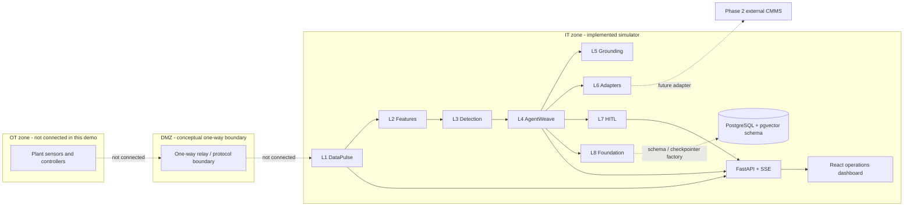
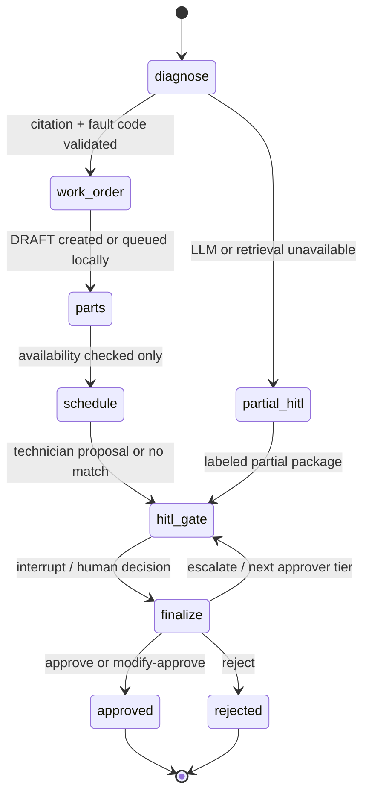

# Agentic Maintenance Workflow

An independent, simulated maintenance-operations demo. It turns generated sensor readings into anomaly events, retrieves source passages from synthetic manuals, drafts a work order, checks inventory and technician fit, and pauses for human approval before confirming work or reserving parts. Workflow decisions are recorded in a SHA-256 hash-chained audit ledger.

## Scope and Safety

- The plant and all telemetry are simulated. There is no OT connectivity, PLC/MQTT bridge, or one-way relay implementation.
- CMMS, inventory, and scheduling are in-memory mocks behind adapter interfaces. Maximo and SAP PM classes are non-operational stubs that raise `NotImplementedError`.
- The API demo runtime stores state in process memory. SQLAlchemy metadata, an Alembic schema, and a Postgres checkpointer factory are provided, but the live API is not yet wired to persist its runtime records or resume them after a restart.
- The manuals are synthetic demo content, not OEM documentation. Do not use them for real maintenance or clinical service instructions.
- The development approver header is an identity hook only, not production authentication. Add OIDC/API-key verification, authorization, TLS, and secrets management before deployment.
- No action is automatically approved. Availability checks are read-only; part reservations are created only after an approve or modify-approve decision.
- Missing safety classification is treated as safety-critical.

## Contents

- [Architecture](#architecture)
- [Layers](#layers)
- [Approval Rules](#approval-rules)
- [LLM Use](#llm-use)
- [Dashboard](#dashboard)
- [Quick Start](#quick-start)
- [Configuration](#configuration)
- [Targets](#targets)
- [Repository](#repository)
- [Roadmap](#roadmap)

## Architecture

The OT/DMZ diagram shows the intended trust boundary, not a deployed connectivity path. The current build starts at the simulator inside the IT demo runtime.



```mermaid
sequenceDiagram
  participant Sim as Simulator
  participant Det as Feature + detector pipeline
  participant Agent as Workflow runner
  participant Docs as Manual retriever
  participant Mock as Mock adapters
  participant Human as Approver
  participant Audit as Hash-chain ledger
  Sim->>Det: canonical telemetry
  Det->>Agent: anomaly event
  Agent->>Docs: retrieve chunks filtered by asset class
  Docs-->>Agent: synthetic passages + metadata
  Agent->>Agent: validate fault code and exact citation
  Agent->>Mock: create idempotent DRAFT work order
  Agent->>Mock: read-only availability check
  Agent->>Mock: propose qualified technician
  Agent->>Audit: trace + approval-request event
  Agent-->>Human: approval package, pending decision
  Human->>Agent: approve / modify / reject / escalate
  alt approve or modify-approve
    Agent->>Mock: update work order; commit reservations
  else reject
    Agent->>Mock: mark draft rejected; reserve nothing
  else escalate
    Agent-->>Human: route to next tier; restart SLA
  end
  Agent->>Audit: decision and finalization events
```



### Layer Map

| Layer | Responsibility | Main modules |
| --- | --- | --- |
| L1 DataPulse | Seeded scenarios, normalization, queue bus, processing loop | `backend/app/datapulse/` |
| L2 Features | Rolling windows, vibration peaks, health index | `backend/app/datapulse_ai/features.py` |
| L3 Detection | SPC/CUSUM, optional Isolation Forest, ensemble, suppression | `backend/app/datapulse_ai/detection/` |
| L4 AgentWeave | Policy, typed workflow state, LangGraph gate declaration, demo runner | `backend/app/agentweave/` |
| L5 Grounding | Synthetic manual chunks, fault library, retrieval, citation validation | `backend/app/grounding/` |
| L6 Adapters | CMMS, inventory, scheduling contracts and mocks | `backend/app/adapters/` |
| L7 HITL | Approval service, SLA warning/escalation, notifier | `backend/app/hitl/` |
| L8 Foundation | Hash ledger, SQLAlchemy metadata, Alembic, DB/checkpointer helpers | `backend/app/foundation/`, `backend/alembic/` |

## Approval Rules

| Condition | Required behavior |
| --- | --- |
| Any workflow | Human decision is mandatory; automatic approval is not implemented. |
| `safety_critical=true` | Route to human and show `safety_critical`. |
| `safety_critical=null` | Treat as safety-critical and show missing-classification reason. |
| Selected confidence below `HITL_MIN_CONFIDENCE` | Flag `low_confidence`. |
| Missing citation or unknown fault code | Mark candidate unverified and lower confidence; never silently pass. |
| Estimated cost over threshold | Require at least approver tier 2. |
| Parts | Check before approval; reserve only after approval. Rejection reserves nothing. |
| LangGraph gate | `interrupt()` is isolated from adapter side effects because the node restarts on resume. |

## LLM Use

| Mode | Behavior |
| --- | --- |
| `LLM_MODE=fake` | Deterministic diagnosis and work-order proposal fixtures; no API key required. |
| `LLM_MODE=groq` | Groq SDK, JSON schema response format, retry/backoff, then fast-model JSON fallback. |
| Default models | `openai/gpt-oss-120b` primary and `openai/gpt-oss-20b` fast; override via environment. |
| Side effects | Never available to the model. Code validates output and calls adapters. |

Groq availability and current strict-schema constraints should be checked against the [Groq structured output docs](https://console.groq.com/docs/structured-outputs). Prompts tell the model to cite only supplied passages and treat manual text as data. Fastembed is optional; the current retriever has a keyword scoring fallback and does not assume provider embeddings.

## Dashboard

| Page | Primary view |
| --- | --- |
| Command Center | KPIs, L1-L8 status, signal chart, fleet health, approval preview, agent events |
| Anomalies | Filterable events and evidence drawer |
| Approvals | SLA-sorted queue, diagnosis/citations, editable draft, parts, technician, four decision actions |
| Workflow Trace | Per-node outcome and latency timeline |
| Assets & Health | Fleet register and recent telemetry chart |
| Audit Ledger | Correlation filter, hash prefixes, chain verification |
| LLM & System | Model stats, adapters, guardrails, unmeasured SLO status |
| Simulator | Scenario injection, pause/resume/reset, dependency failure toggles |

## Quick Start

Requirements: Python 3.11+, Docker Desktop with the Linux container engine running, and (for local frontend development without Docker) Node.js 20+ with npm.

```powershell
Copy-Item .env.example .env
make up
make seed
make backend
```

Then start the dashboard in another terminal with `make frontend` and open `http://localhost:5173`. The API is at `http://localhost:8000`; OpenAPI is at `http://localhost:8000/docs`.

`make up` starts PostgreSQL. `make seed` applies migrations and inserts seed rows. The current API runtime remains in memory, so the database does not yet back the live dashboard state. `make frontend` runs the Vite dev server in a Node container so host Node is optional when Docker is working. To run the full Compose stack directly, use `docker compose up --build`.

For a no-database offline workflow test, from the repository root run:

```powershell
Push-Location backend
python -m scripts.e2e_demo
Pop-Location
```

The demo prints its approval package, confirms that no parts were reserved before approval, finalizes an approval, and verifies the in-memory ledger.

## Configuration

Copy `.env.example` to `.env`. Secrets are environment-only and `.env` is ignored by Git.

| Variable | Default | Purpose |
| --- | --- | --- |
| `GROQ_API_KEY` | empty | Groq credential; only needed in Groq mode |
| `GROQ_MODEL_PRIMARY` | `openai/gpt-oss-120b` | Primary model |
| `GROQ_MODEL_FAST` | `openai/gpt-oss-20b` | Fallback model |
| `GROQ_TIMEOUT_SECONDS` | `30` | SDK timeout |
| `GROQ_MAX_RETRIES` | `3` | Primary retry attempts |
| `LLM_MODE` | `fake` | `fake` or `groq` |
| `DATABASE_URL` | local pg/asyncpg URL | SQLAlchemy/Postgres URL |
| `HITL_MIN_CONFIDENCE` | `0.70` | Confidence gate threshold |
| `SPEND_APPROVAL_THRESHOLD_USD` | `5000` | Minimum approver tier becomes 2 above this cost |
| `ALERT_QUIET_PERIOD_MINUTES` | `5` | Per-asset/type quiet window |
| `ALERT_DEDUP_WINDOW_MINUTES` | `15` | Duplicate suppression window |
| `SLA_TIER1_MINUTES` | `15` | Tier 1 SLA |
| `SLA_TIER2_MINUTES` | `60` | Tier 2 SLA |
| `SLA_TIER3_MINUTES` | `240` | Tier 3 SLA |
| `PIPELINE_MODE` | `live` | `live` or `shadow` |
| `CMMS_ADAPTER` | `mock` | `mock`, `maximo` stub, or `sap_pm` stub |
| `INVENTORY_ADAPTER` | `mock` | Inventory adapter setting |
| `SCHEDULER_ADAPTER` | `mock` | Scheduler adapter setting |
| `LABOR_RATE_USD_PER_HOUR` | `110` | Deterministic cost calculation |
| `VITE_API_BASE_URL` | `http://localhost:8000/api/v1` | Browser API/SSE endpoint |

## Targets

These are acceptance targets, not measured results. All available detection measurements are explicitly on synthetic simulator data; no real-world performance claim is made.

| Metric | Target | Current measured result |
| --- | --- | --- |
| Labeled synthetic detection precision | `>85%` | Not measured: `scikit-learn` is absent in this environment; see `docs/DETECTION_EVALUATION.md`. |
| Signal-to-anomaly latency | `<60 s` | Not measured |
| Anomaly-to-draft work order | `<5 min` | Not measured |
| Anomaly-to-HITL notification | `<10 min` | Not measured |
| Safety-critical human routing | `100%` | Unit and API tests cover the seeded safety-critical and unclassified cases. |

## Repository

```text
.
├── backend/
│   ├── alembic/                 # Initial PostgreSQL schema migration
│   ├── app/                     # FastAPI, telemetry, detection, agents, grounding, adapters, HITL
│   ├── scripts/                 # Seed, simulate, evaluate, e2e demo
│   └── tests/
├── data/
│   ├── manuals/                 # Synthetic demo manuals
│   └── seed/                    # Assets, inventory, technicians
├── docs/                        # API, decisions, research, work plan, demo
├── frontend/
│   └── src/                     # Typed React ops dashboard
├── .github/workflows/ci.yml
├── docker-compose.yml
└── Makefile
```

## Roadmap

1. Wire process services to SQLAlchemy/PostgreSQL and load the LangGraph Postgres checkpointer at application startup.
2. Exercise the real LangGraph pause/resume path in CI and make API decisions resume that graph rather than the offline runner facade.
3. Install scikit-learn in the evaluation environment, run the labeled synthetic benchmark, and publish measured precision/recall/latency without tuning against test labels.
4. Generate and commit a lockfile; run `tsc --noEmit` and `vite build` in the current development environment.
5. Add auth middleware, persistence-backed SSE, SLA background scheduling, KPI snapshots, and frontend component tests.
6. Only after these gates, consider public bearing data replay and carefully scoped vendor sandbox adapters.

This repository is an independent implementation and is not affiliated with or endorsed by Groq, LangChain, IBM, SAP, or any equipment manufacturer.
